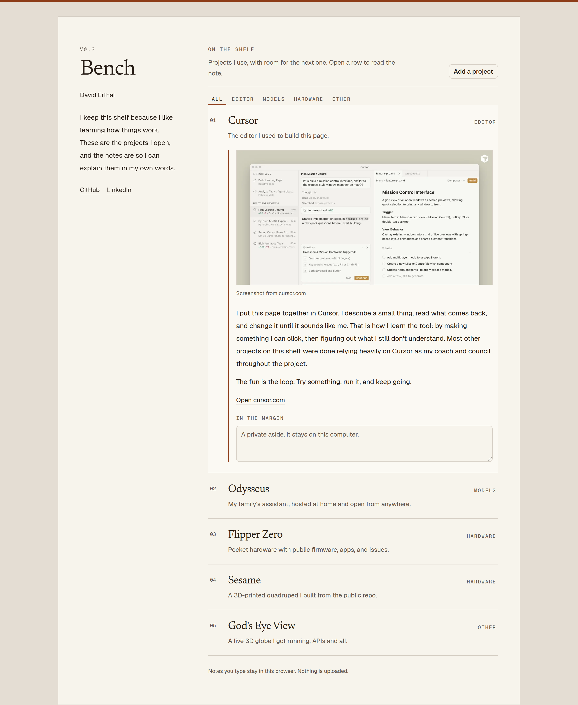

# Bench

A small shelf of the projects David Erthal actually uses.

David Erthal keeps a shelf of projects he uses and learns from: Cursor, [Odysseus](https://github.com/odysseus-dev/odysseus), [Flipper Zero](https://github.com/flipperdevices/flipperzero-firmware), [Sesame](https://github.com/dorianborian/sesame-robot), and [God's Eye View](https://github.com/bilawalsidhu/gods-eye-view), with room to add the next thing. Notes typed into the page stay in the browser. Nothing is uploaded.



## Run it

```bash
npm install
npm run dev
```

Open the URL Next prints. `npm test` checks the shelf logic. `npm run lint` checks the code.

## Where things live

| File | What it is |
| --- | --- |
| `src/lib/shelf.ts` | The writeups, plus the rules for adding a project |
| `public/shelf/` | Photos for the notes, including David's own Odysseus. |
| `src/components/bench.tsx` | The page: open a row, filter, type a margin note |
| `src/components/add-project-dialog.tsx` | The form for a project of your own |
| `profile/README.md` | The text for a GitHub profile page |
